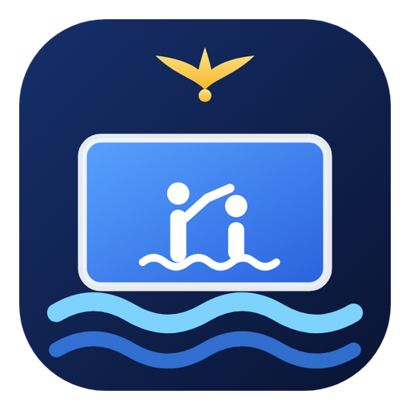
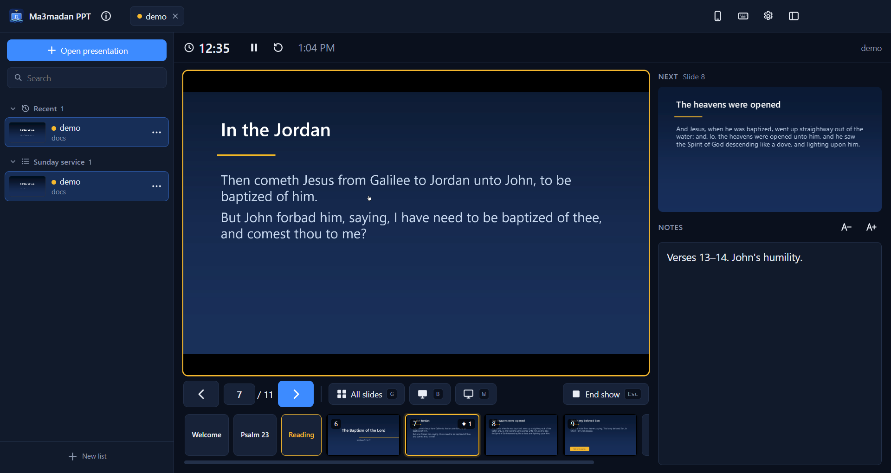
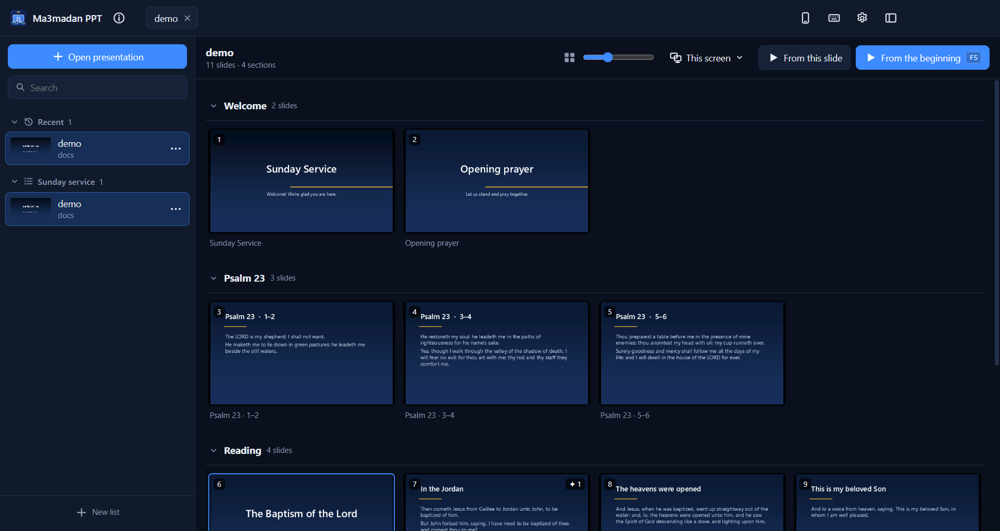

<p align="center">
  
</p>

<h1 align="center">Ma3madan PPT</h1>

<p align="center">
  <b>A presenter view for PowerPoint, made for the people running the slides.</b><br>
  Your slides full screen on the projector. On your laptop: the live slide, the next one, your notes, every section, and a phone remote.
</p>

<p align="center">
  <a href="https://github.com/michaelsaad/ma3madan-ppt/releases/latest"><b>⬇ Download for Windows</b></a>
</p>



## Why this app?

Running slides for a meeting, a church service or a class usually means juggling:

- 📂 Several presentations (the songs, the sermon, the announcements), each opened, closed and searched for in a folder while everyone waits.
- 🔎 Hunting for slide 47 in a long deck, because the reading moved or the choir changed the order of the songs.
- 🧭 Long presentations split into sections in PowerPoint, with no quick way to jump to one while presenting.
- 📱 Having to stand by the laptop the whole time.

**Ma3madan PPT keeps PowerPoint for what it does best and gives you the rest.** PowerPoint itself shows the slides on the projector, so animations, transitions, videos, fonts and links all work exactly as the author made them. Everything around it is on your laptop: your presentations, their sections, a grid of every slide, and the presenter view. Your phone is a remote that can do all of it too.

*Ma3madan* (المعمدان) is named after St. John the Baptist. To the glory of God’s name, made for **St. John the Baptist Church in Qalyub, Al-Qalyubia, Egypt**. Free and open source, for any ministry and any work. It has a sister app for videos: [Ma3madan Play](https://github.com/michaelsaad/ma3madan-play).

## Features

- **Presenter view.** The slide on the projector, live (animations and videos included), the next slide or the next animation step, your notes in a size you can read, a timer and the clock. Type a slide number and press `Enter` to jump there.
- **Click on the slide.** Click the live slide on your laptop, or tap it on your phone, and it's like clicking on the projector: links, "go to slide" buttons and action buttons all work.
- **Sections.** PowerPoint's sections show as chips under the live slide, with that section's slides beside them. One click jumps to a section.
- **All slides** (`G`): a big grid of every slide, grouped by section. Open and close sections, make the slides bigger or smaller, and click any slide to go there.
- **Before the show:** the same grid with each section's slides, a **Start here** on every section, and **From this slide**.
- **Black and white screens** (`B`, `W`) for the moments the projector should show nothing.
- **Your presentations, in one place.**
  - **Recent:** every presentation you opened, with a picture of its first slide.
  - **Lists:** make one for each meeting ("Sunday service"), add presentations from their **⋯** menu or by dragging them onto the list, open them all at once.
  - **Search** across all of them.
  - Several presentations open at the same time, as tabs at the top: switch with a click or `Ctrl + Tab`.
  - It remembers the slide you stopped at in each one.
- **Phone remote.** Turn it on and scan the QR code once: the [Ma3madan Remote](https://ma3madan-remote.pages.dev) app opens on the phone (add it to the home screen) and connects by itself from then on, in about a second. Or pick this computer from **Computers on this Wi-Fi** in the app and approve it here. On the phone: the live slide (tap it to click on it), next and back, black, white, end, your notes, the timer, every section with its slides, and your presentations, recents and lists to open or start.
  - **One connection with Ma3madan Play.** When both apps are open, the phone has one connection to the computer and a tab for each: one QR code, one approval.
  - **Trusted phones.** Each phone gets a key of its own. See them in the remote's window and **Forget** any one of them, or all.
  - **Works on more networks.** Directly over the Wi-Fi when it can; through an encrypted relay when the Wi-Fi keeps devices apart (guest and church networks often do) or the phone is on mobile data.
  - **No internet at all?** Scan the code under **No internet here?**: the same remote, served by this computer on the local network.
- **Edit while you present.** Presentations open read-only in the background, so the file stays untouched and you can still open it in PowerPoint to fix a typo (**⋯** → **Edit in PowerPoint**).
- **Choose the screen** for the show (**This screen / Screen 2 ▾**), or let the app pick the projector by itself. The show fills that screen exactly, whatever its resolution or scaling (125 %, 150 %…), with no taskbar over it, also through HDMI splitters that feed several screens.
- **English and Arabic** interface (Arabic is right-to-left), **light and dark** themes that follow Windows, and every shortcut one `?` away.
- **Always ready, in the tray.** The window's ✕ keeps the app running next to the clock, so the phone remote stays connected; click the icon to open it, right-click it to quit. It also starts with Windows, hidden there (turn that off in Task Manager → Startup apps).
- **Opens presentations from Explorer** (`.pptx`, `.ppt`, `.ppsx`, `.pps`, `.pptm`, `.ppsm`).



## Install

You need **Microsoft PowerPoint** (2013 or later, including Microsoft 365) on the same computer: Ma3madan PPT uses it to show the slides.

1. Download **`Ma3madan-PPT-Setup-x.y.z.exe`** from the [latest release](https://github.com/michaelsaad/ma3madan-ppt/releases/latest).
2. Run it. Because the app is new and not code-signed yet, Edge or Windows may warn you first. See [Windows says the file is unsafe](#windows-says-the-file-is-unsafe) below.
3. Pick where to install it. No admin rights are needed. Installed for all users, it also lets the phone remote through the Windows firewall on private networks; otherwise Windows asks once, the first time (choose **Private networks**).

Prefer not to install? Download **`Ma3madan-PPT-Portable-x.y.z.exe`** and run it from anywhere.

Requirements: Windows 10 or 11 (64-bit) and PowerPoint.

### Windows says the file is unsafe

Edge and Windows SmartScreen warn about any new program that isn't code-signed and hasn't been downloaded by many people yet. The warning is about reputation, not about anything found in the file. All the source code is in this repository, and every release is built from it.

- **Edge** ("isn't commonly downloaded"): open Downloads (`Ctrl + J`), hover over the file, click **⋯** → **Keep** → **Show more** → **Keep anyway**.
- **Windows SmartScreen** ("Windows protected your PC"): click **More info** → **Run anyway**.

### Updates

The app updates itself. It looks for a new version a little after it starts and every few hours (or right away with **ⓘ** → **Check for updates**). When one is out, an **Update** button appears in the top bar. Nothing changes until you click it, and never during a show. The app downloads the new installer, checks it against the SHA-256 that GitHub publishes for the file, installs it and restarts. The portable version's button opens the download page instead.

## Using it with a projector

1. Connect the projector and press **`Win + P`**, then choose **Extend**.
2. Open your presentation in Ma3madan PPT (or pick it from Recent or a list).
3. Press **From the beginning** (`F5`), or select a slide and press **From this slide** (`Shift + F5`). The show goes full screen on the projector and the presenter view opens on your laptop.
4. To use another screen, pick it under **Screen ▾** before starting.

With only one screen, the show fills that screen like in PowerPoint; use the keyboard or the phone remote to move through it.

If a screen is plugged in or changes resolution during the show, the show fills it again by itself.

## Keyboard shortcuts

| Keys | |
|---|---|
| `F5` / `Shift + F5` | Start from the beginning / from the selected slide |
| `→` `Space` `PgDn` | Next animation or slide |
| `←` `PgUp` | Previous |
| a number, then `Enter` | Go to that slide |
| `Home` / `End` | First / last slide |
| `G` | All slides |
| `B` / `W` | Black / white screen |
| `Esc` | End the show |
| `Ctrl + O` | Open a presentation |
| `Ctrl + Tab` | Next open presentation |
| `Ctrl + B` | Side panel |
| `?` | All shortcuts |

## Build from source

```bash
npm install
npm start
```

- `npm test` runs the app against `test/test.pptx` with the real PowerPoint: sections, thumbnails, a full-screen show, next and back, animation steps, the slide grid, clicking a link and a button on a slide, the black screen, and the phone remote's commands. It takes over the screen for about a minute.
- `npm run test:bridge` checks only the PowerPoint connection.
- `npm run test:remote` opens the app with the phone remote on and prints the pairing link.
- `npm run shots` remakes the screenshots above from `docs/demo.pptx` (made by `docs/make-demo.js`).

### How it works

- `src/ppt/host.js` runs under Windows Script Host and talks to PowerPoint through COM (late-bound, so it works with any installed Office, 32- or 64-bit): opening presentations read-only without a window, sections, notes, slide pictures, and the slide show itself.
- `src/ppt/win.ps1` does what COM can't: it finds the show window, fills the chosen screen with it (in real pixels, aware of each screen's own scaling), and clicks inside it. PowerPoint is also told the screen before the show starts, so it opens there at once.
- A click on a slide first goes to PowerPoint, which finds the shape there and runs its action (a link, "go to slide", next, end…). Anything else becomes a real click on the projector.
- The live slide in the presenter view is a capture of the show window.
- The phone remote is the [Ma3madan Remote](https://github.com/michaelsaad/ma3madan-remote) app over an encrypted WebRTC connection. These files are shared with Ma3madan Play:
  - `src/hub.js`: one link for both apps. The first app with the remote on holds it; the other joins it over a named pipe and takes over if the first one closes.
  - `src/link-host.js` · `src/link.js`: the WebRTC side, and the pairing, keys and signaling.
  - `src/lan.js` · `src/phone/`: the Wi-Fi page for places with no internet (a copy of the phone app; `npm run phone` refreshes it).

### Releasing

Releases are built by GitHub Actions ([`.github/workflows/release.yml`](.github/workflows/release.yml)), like Ma3madan Play's:

1. Bump `version` in `package.json` and commit.
2. Push a matching tag: `git tag v1.2.0 && git push origin v1.2.0`.
3. The workflow builds the installer and the portable `.exe` (and signs them once code signing is set up) and creates a **draft** release with both. Check it, write the notes, and publish.

The app's updater finds the newest release and checks the installer against the SHA-256 GitHub shows for it. `npm run dist` builds the same files locally into `dist/`.

## Privacy

The app doesn't collect, store or send any personal data or usage statistics. Your presentations never leave your computer. It connects to the internet only to check GitHub for app updates and, when you turn the phone remote on, to find your phone: the Ma3madan Remote app meets the computer through a signaling server that passes on only encrypted messages and keeps none of them, then talks to it directly over the Wi-Fi (or through an encrypted relay that can't read it either). The slide pictures, notes and titles the phone shows travel only over that encrypted connection. A link in a slide to a program or to a file on another computer is left to PowerPoint, which asks before opening it.

## Third-party software

- [Electron](https://www.electronjs.org/) (MIT), bundled
- [QR Code Generator](https://github.com/kazuhikoarase/qrcode-generator) by Kazuhiko Arase (MIT), bundled for the phone remote's QR code
- Microsoft PowerPoint, which you install yourself, under its own license. Ma3madan PPT is an independent app, not made by or affiliated with Microsoft.

The demo presentation uses Psalm 23 and Matthew 3 from the King James Version (public domain).

## License

Free to use for any person or organization, for any purpose: use it, copy it, change it and share it ([MIT License](LICENSE)).

The app is provided as is, without warranty of any kind, and may contain bugs. Please try it before relying on it at an important event. If you find a problem, [open an issue](https://github.com/michaelsaad/ma3madan-ppt/issues).

---

<p align="center">Developed by Michael Saad · © 2026</p>
